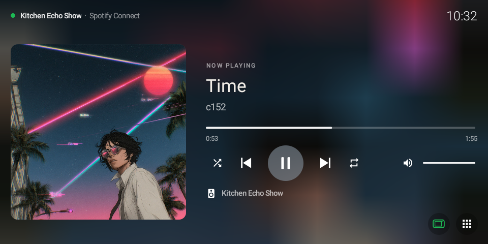
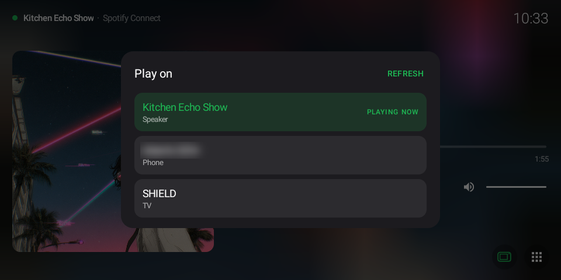
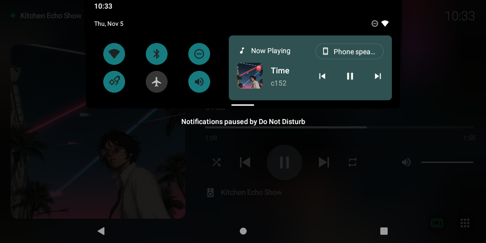
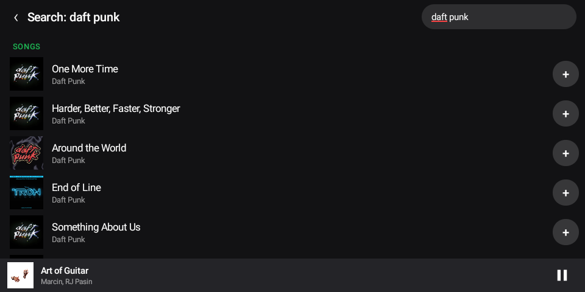
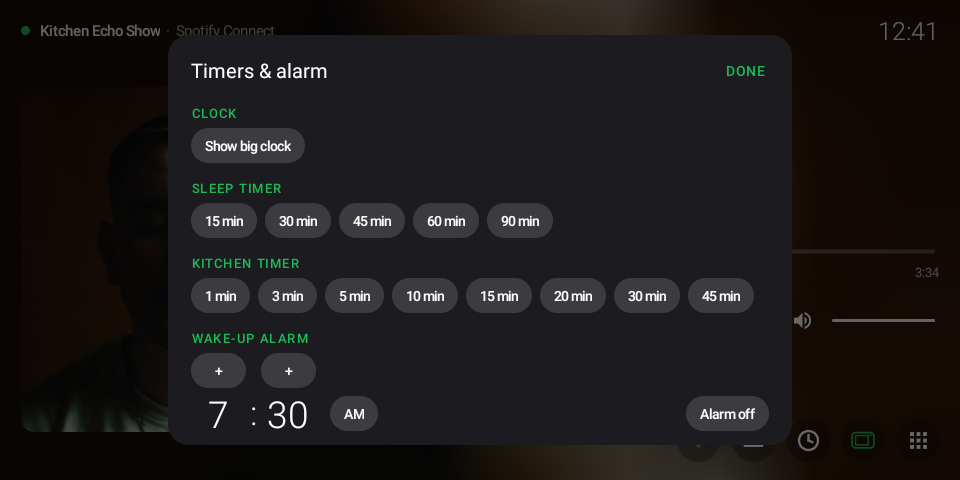
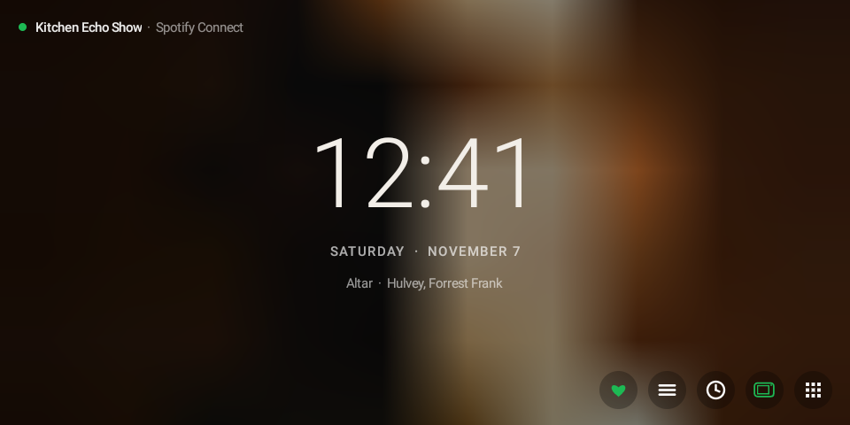

# Echo Show Now Playing

Turn a rooted **Amazon Echo Show 5** (codename *checkers*, running LineageOS 18.1) into a real
**Spotify Connect speaker** with a full-screen Now Playing display.

- Pick the Echo in Spotify on your phone and the music plays through the Echo's own speaker.
- A Now Playing app shows album art (blurred into the background), title, artist, a live progress
  bar and controls: play/pause, previous/next, seek, shuffle, repeat, volume and mute.
- The same controls appear in the notification shade, over the lock screen, in a home-screen widget
  and in a screensaver. Tapping anything that isn't a control opens Now Playing.
- A Spotify-style device line shows where the music is playing. The Echo button jumps playback to
  the Echo; when the Echo is already playing, it opens a device picker that moves playback to any
  of your Spotify Connect devices.
- Now Playing opens on its own when music starts from your phone while the home screen is showing,
  and stays out of the way when another app is in front.
- Browse and play your Spotify library from the Echo: playlists, liked songs, albums, followed
  artists, recently played, top tracks and the queue. Search songs, artists, albums and playlists.
  Touch and hold a playlist, album or artist to pin it as a one-tap preset. A heart button likes
  the current song.
- Sleep timer (fades out, then pauses), up to four kitchen timers with a countdown on every screen,
  a wake-up alarm that starts a playlist at a slowly rising volume, and a big clock.
- Everything starts at boot.

| Now Playing | Device picker |
|---|---|
|  |  |

| Notification shade | Library search |
|---|---|
|  |  |

| Timers and alarm | Big clock |
|---|---|
|  |  |

The screensaver shows the Now Playing view, or the clock with one-tap pinned playlists when nothing is playing.

The receiver is Spotify's official headless Connect client, **Soloist**, so playback, login and
audio keys work the way Spotify intends (no reverse-engineered protocol).

> Not affiliated with Spotify or Amazon. Soloist is proprietary and **not included**; you need your
> own copy and developer API key from Spotify, plus Spotify Premium.

## How it fits together

```
Spotify app (phone) ──Connect──▶ Soloist (linux/arm, Debian 13 chroot)
                                   │ PipeWire client
                                   ▼
                     PipeWire + WirePlumber (chroot)
                                   │ module-pulse-tunnel (tcp:127.0.0.1:4713)
                                   ▼
                     PulseAudio in Termux ──OpenSL ES──▶ Echo speaker

Now Playing app ◀──WebSocket ws://127.0.0.1:9090── Soloist control API
                ◀──HTTPS──────────────────────────── Spotify Web API (device list, transfer)
```

- `device/` runs on the Echo as root, started by an Android init service at boot.
- The app (`src/`, `res/`) is a normal unprivileged Android app with no dependencies.

## Things that had to be solved on this hardware

| Problem | Cause | Fix |
|---|---|---|
| Soloist froze at 100% CPU ~30 s after start and whenever a login began | Soloist's 32-bit build targets ARMv6 and uses CP15 barrier instructions inside `ldrex`/`strex` loops. The 64-bit kernel emulates CP15 barriers by default, each trap clears the exclusive monitor, so the store never succeeds | `echo 2 > /proc/sys/abi/cp15_barrier` (run them in hardware) |
| Every timeout fired instantly in an Ubuntu 26.04 chroot (`read -t 1` returned in <1 ms, DNS lookups failed) | Kernel 4.9 lacks the 64-bit-time syscalls and Ubuntu's glibc 2.43 has no fallback | Use a Debian 13 chroot (glibc 2.41 falls back correctly) |
| `apt` couldn't resolve anything inside the chroot | Android only lets members of the `inet` group open sockets; apt downloads as the `_apt` user | `APT::Sandbox::User "root";` |
| Soloist's own mDNS announcements never reached phones | Its built-in responder fails on this device | Advertise `_spotify-connect._tcp` with python-zeroconf (TXT record `CPath` only) |
| No sound | Soloist only supports PipeWire output | PipeWire in the chroot, tunnelled to Termux's PulseAudio |
| Boot service died ~10 s after boot | Android init kills a service's whole process group when its main process exits | `start_all.sh` ends by `exec`-ing the watchdog |
| No device list in Soloist's API | Its WebSocket API only has `activate`/`deactivate` | Spotify Web API with PKCE sign-in |

## Requirements

- Echo Show 5 (checkers) with LineageOS 18.1, `adb root` and a writable `/system` (`adb remount`).
- [Termux](https://termux.dev) with `python`, `pulseaudio` and `proot-distro`, plus `pip install zeroconf`.
- A Debian 13 container: `proot-distro install debian:13 --name debian`.
  Inside it (as root, with the apt fix above): `apt install pipewire pipewire-bin wireplumber ca-certificates`.
- Soloist for linux/arm (32-bit) at `/root/soloist` inside the Debian container, and a Soloist API key.
- Spotify Premium.
- Optional, for the device picker: a Spotify developer app with the Web API enabled and the redirect
  URI `http://127.0.0.1:8888/callback`, plus Firefox on the Echo for the one-time sign-in.

## Install

### 1. Device side

```bash
adb connect <echo-ip>:5555
adb root
```

Create `/data/local/echo-spotify/config.env` on the Echo from
[`device/config.env.example`](device/config.env.example) (it holds your Soloist key, so `chmod 600`),
then from this repo:

```bash
./device/deploy.sh <echo-ip>:5555
```

This copies the scripts to `/data/local/echo-spotify/`, installs the PipeWire configs into the
Debian container, installs `/system/etc/init/echo-spotify.rc`, and starts the service.
Logs: `/data/local/echo-spotify/boot.log` and `watchdog.log`.

### 2. The app

```bash
ANDROID_SDK=/path/to/android-sdk ./build.sh    # needs build-tools 35.0.0, platform android-30, JDK 17
adb install -r build/NowPlaying.apk
```

`build.sh` signs with `~/.android/debug.keystore` unless `KEYSTORE`, `KS_PASS` and `KS_ALIAS` say
otherwise. Settings can also go in an untracked `local.env` next to `build.sh`.

Grant the two permissions used for auto-open, and set the screensaver:

```bash
adb shell appops set com.adam.nowplaying GET_USAGE_STATS allow
adb shell appops set com.adam.nowplaying SYSTEM_ALERT_WINDOW allow
adb shell settings put secure screensaver_enabled 1
adb shell settings put secure screensaver_components com.adam.nowplaying/com.adam.nowplaying.NowPlayingDream
adb shell settings put secure screensaver_activate_on_sleep 1
```

Add the widget from the launcher's widget list.

**Photo screensaver (optional).** `PhotoDream` plays the pictures of a Google Photos album that is
shared with a link (Google closed its official API to existing albums in 2025, so this reads the
public share page; it needs no sign-in but is unofficial and could stop working if Google changes
that page). Anyone with the link can view the album. Give the app the link, then pick it as the
screensaver:

```bash
adb shell am start -n com.adam.nowplaying/.MainActivity --es album_url "https://photos.app.goo.gl/<your-link>"
adb shell settings put secure screensaver_components com.adam.nowplaying/com.adam.nowplaying.PhotoDream
```

Use `com.adam.nowplaying.NowPlayingDream` instead to go back to the Now Playing screensaver.

Controls: swipe left or right for the next or previous picture; tap for a control bar (previous,
pause photos, next, Now Playing, Exit, plus music controls while something is loaded); double-tap
to open Now Playing.

### 3. Library, search and device picker (optional)

Link your Spotify developer app and start the one-time sign-in; Firefox opens on the Echo, and
after you tap **Agree** the app stays signed in. This one sign-in covers the device picker, library,
search, queue and like button; the Library button asks you to sign in again if you installed an
older version. Spotify only lets apps list the songs of playlists you own, so for other people's
playlists the app offers **Play playlist** instead of a track list, and Spotify's own
algorithmic playlists and recommendations are not available to apps like this.

```bash
adb shell am start-foreground-service -n com.adam.nowplaying/.PlayerService \
  -a com.adam.nowplaying.LOGIN --es client_id <your-client-id>
```

## Layout

```
src/com/adam/nowplaying/
  SoloistClient     minimal WebSocket client for Soloist's control API
  PlayerState       playback state shared by every surface
  PlayerService     always-on foreground service: media session, notification, widget, auto-open
  NowPlayingView    the player (Rusty-inspired look), used by the app and the screensaver
  MainActivity      full-screen app, device picker, Echo/home buttons
  NowPlayingDream   screensaver
  NowPlayingWidget  home-screen widget
  PhotoDream        photo-album screensaver (PhotoAlbum reads the shared-album link)
  SpotifyWebApi     PKCE sign-in, device list, transfer, track lookup, library/search/play calls
  LibraryPanel      library, search and queue browser; Pins stores the pinned presets
  ToolsPanel        sleep timer, kitchen timers, wake-up alarm; Timers/AlarmReceiver run them
device/
  start_all.sh      boot entry point (run by echo-spotify.rc)
  start_pw.sh       PipeWire + WirePlumber in the chroot
  soloist_watchdog.py  runs Soloist, advertises it via mDNS, restarts it if it stops answering
  as_termux.py      runs a command as the Termux user (used to start PulseAudio)
  pipewire/         PipeWire tunnel + WirePlumber chroot configs
  deploy.sh         installs all of the above over adb
```

## License

MIT, see [LICENSE](LICENSE). The visual style is inspired by
[Rusty](https://github.com/SerafiniJose/rusty).
